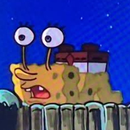

# Long Eyes



Fabric-Mod für **Minecraft Java 26.1.2**: Halte **C** gedrückt, um zu zoomen – und deine Augen
fahren aus dem Kopf, wie in *The Long Drive*. Je weiter du mit dem Mausrad
hineinzoomst, desto weiter fahren sie heraus. Andere Spieler sehen das live.

| Komponente | Version |
|---|---|
| Minecraft | 26.1.2 (unobfuskiert, offizielle Mojang-Namen) |
| Fabric Loader | ≥ 0.18.4 (getestet mit 0.20.1) |
| Fabric API | 0.155.3+26.1.2 |
| Fabric Loom | 1.19-SNAPSHOT (`net.fabricmc.fabric-loom`) |
| Gradle | 9.8.2 (Wrapper) |
| Java | 25 |

---

## Installation

### Client
1. Fabric Loader für 26.1.2 installieren (https://fabricmc.net/use/).
2. `fabric-api-0.155.3+26.1.2.jar` (oder neuer für 26.1.2) in `.minecraft/mods/` legen.
3. `long-eyes-1.3.1.jar` in `.minecraft/mods/` legen.

### Server (für Multiplayer-Sichtbarkeit)
1. Fabric-Server 26.1.2 installieren.
2. Fabric API und `long-eyes-1.3.1.jar` in den `mods/`-Ordner des Servers legen.
3. Alle Spieler, die die Augen sehen bzw. zeigen sollen, brauchen die Mod ebenfalls auf dem Client.

Die Mod läuft auf einem dedizierten Server, ohne Client- oder Rendering-Klassen zu laden
(`splitEnvironmentSourceSets`, Client-Code liegt ausschließlich in `src/client`).
Auf Servern ohne die Mod funktioniert der Zoom lokal weiter; es werden dann einfach keine Pakete gesendet.

---

## Steuerung

| Eingabe | Wirkung |
|---|---|
| **C** halten | Zoom an (Start 2×), Augen fahren leicht aus |
| **C + Mausrad hoch** | stärker zoomen (bis 40×), Augen fahren bis 20× weiter aus |
| **C + Mausrad runter** | herauszoomen (bis 1×), Augen fahren ein |
| **C** loslassen | Zoom aus, Augen ziehen sich vollständig zurück |
| **K** | Augenstil wechseln: Stielaugen ↔ Cartoon-Augen (wird gespeichert) |

### Augenstile

| Stil | Aussehen |
|---|---|
| **Stielaugen** (`stalk`, Standard) | Augäpfel auf langen, dünnen Teleskopstielen – wie Spongebob als Schnecke |
| **Cartoon-Augen** (`cartoon`) | Kein Stiel: nur der Augapfel kommt heraus, das Weiße wird zu einer langen Röhre gezogen, vorne sitzt die Pupille – wie bei Patrick |

Der Stil ist eine **persönliche Anzeigeeinstellung**: Jeder Client zeigt die Augen *aller* Spieler in dem
Stil, den er selbst eingestellt hat. Wer Cartoon-Augen wählt, sieht bei allen Patrick-Augen – wer Stielaugen
wählt, sieht bei allen Stielaugen. Der Stil wird deshalb nicht übertragen.

* Während des Zoomens wechselt das Mausrad **keine** Hotbar-Slots; danach ist es wieder normal.
* Während des Zoomens gleitet die Kamera weich hinterher (filmische Kamera) – die Vanilla-Option selbst
  wird dabei nicht verändert.
* Während des Zoomens wird die eigene Hand (Ego-Ansicht) ausgeblendet – nur im eigenen Bild. Andere Spieler
  sehen Arm und Item unverändert, und am gehaltenen Item ändert sich nichts.
* In Menüs/Screens ist der Zoom deaktiviert, Scrollen in Menüs bleibt unverändert.
* Beide Tasten sind unter *Optionen → Steuerung → Tastenbelegung → Long Eyes* umbelegbar.
* Hinweis: Vanilla belegt **C** zusätzlich mit „Schnellleiste speichern“ (nur im Kreativmodus relevant,
  zusammen mit einer Zifferntaste). Bei Bedarf eine der beiden Tasten umbelegen.

### Animation

| Zoom | Augenausfahrung (normiert) |
|---|---|
| 1× / kein Zoom | 0,00 – vollständig eingefahren |
| 2× | 0,23 – leicht ausgefahren |
| 5× | 0,54 – deutlich ausgefahren |
| 10× | 0,77 – lange Stiele |
| 15× | 0,90 – sehr weit |
| 20× | 1,00 – maximal (Standard 1,5 Blöcke) |
| 20×–40× | 1,00 – die Augen bleiben maximal lang, nur die Kamera zoomt weiter |

Die Ausfahrung wird stufenlos logarithmisch aus dem Zoomfaktor berechnet
(`ln(zoom) / ln(eyeFullZoom)`, darüber begrenzt auf 1) und von einer gedämpften Feder animiert: Beim Ausfahren gibt es einen
kleinen Cartoon-Überschwinger (~5 %), beim Einfahren gleiten die Augen weich zurück. Lange Stiele
hängen leicht durch, wackeln minimal und peitschen bei schnellen Bewegungen nach.

---

## Konfiguration

Datei: `config/longeyes.json` (wird beim ersten Start mit Standardwerten angelegt; ungültige
Werte werden beim Laden in gültige Bereiche geklemmt, defektes JSON fällt auf Standardwerte zurück).

| Schlüssel | Standard | Bereich | Bedeutung |
|---|---|---|---|
| `maxZoom` | 40.0 | 1–100 | Maximaler Zoomfaktor |
| `eyeFullZoom` | 20.0 | 1.01–100 | Ab diesem Zoom sind die Augen voll ausgefahren und wachsen nicht weiter |
| `defaultZoom` | 2.0 | 1–maxZoom | Zoom beim Drücken von C |
| `zoomStep` | 1.25 | 1.01–4 | Multiplikator pro Mausradschritt (1.25 = +25 %; 2× → 40× in ca. 13 Schritten) |
| `smoothZoom` | true | – | Weiche Kameraübergänge (false = FOV springt sofort) |
| `cinematicZoom` | true | – | Weiche, gleitende Mausbewegung beim Zoomen (filmische Kamera, nur während des Zooms) |
| `cinematicResponsiveness` | 6.0 | 1–20 | Wie schnell die Kamera nachzieht und stoppt (1 = Vanilla, sehr langes Nachgleiten; 6 = weich, steht nach ca. ½ s) |
| `reduceSensitivity` | true | – | Maus-Empfindlichkeit mit dem Zoom verringern |
| `zoomSensitivityScaling` | 0.35 | 0–1 | Wie stark: Tempo = Zoom^-Wert → 2×: 78 %, 5×: 57 %, 10×: 45 %, 20×: 35 %, 40×: 27 % (0 = nie langsamer, 1 = voll proportional) |
| `hideHandWhileZooming` | true | – | Eigene Hand beim Zoomen ausblenden (nur im eigenen Bild) |
| `eyeStyle` | "stalk" | stalk / cartoon | Augenstil (im Spiel mit K umschaltbar) |
| `maxEyeExtension` | 1.5 | 0.1–8 | Maximale Augenstiel-Länge in Blöcken |
| `eyeExtensionSpeed` | 0.18 | 0.02–1 | Federhärte beim Ausfahren (höher = schneller) |
| `eyeRetractionSpeed` | 0.25 | 0.02–1 | Federhärte beim Einfahren (höher = schneller) |
| `eyeSize` | 0.22 | 0.05–1 | Kantenlänge eines Augapfels in Blöcken |
| `eyeStalkThickness` | 0.06 | 0.01–0.5 | Dicke der Augenstiele in Blöcken |
| `eyeWobble` | true | – | Cartoon-Wackeln/Durchhängen langer Stiele |
| `syncMultiplayer` | true | – | Client: eigenen Zustand senden. Server: Zustände weiterleiten |

Geometrie-/Geschwindigkeitswerte gelten für das, was der jeweilige Client rendert. Übertragen wird
nur die normierte Ausfahrung (0–1), daher funktioniert die Synchronisierung auch bei
unterschiedlichen Configs.

---

## Architektur

```
src/main/java/de/longeyes/          (Client + Server, keine Client-Klassen)
  LongEyes.java                     Common-Entrypoint
  EyeMath.java                           Zoom → Ausfahrung, Netzwerk-Quantisierung
  config/EyesConfig.java                 JSON-Config (Gson), Validierung
  EyeStyle.java                          Augenstile (stalk, cartoon) – nur clientseitige Anzeige
  network/EyeStateC2SPayload.java        Client → Server: Zielausfahrung (0..255)
  network/EyeStateS2CPayload.java        Server → Client: (Entity-ID, Zielausfahrung)
  network/EyeNetworking.java             Payload-Registrierung
  server/EyeSyncServer.java              Validierung, Rate-Limit, Weiterleitung

src/client/java/de/longeyes/client/ (nur Client)
  LongEyesClient.java               Client-Entrypoint, Layer-Registrierung, Tick
  zoom/ZoomController.java               Tastenbelegung, Zoom-Simulation (log-Raum, 20 Hz)
  anim/EyeAnimation.java                 Gedämpfte Feder pro Spieler
  anim/EyeAnimationManager.java          Animationen nach Entity-ID (leer, wenn niemand zoomt)
  network/EyeSyncClient.java             Senden bei Änderung, Empfang, Reset bei Disconnect/Levelwechsel
  render/EyeRenderData.java              RenderState-Daten (RenderStateDataKey)
  render/EyeStalkLayer.java              RenderLayer am Kopf-ModelPart des Spielermodells
  render/EyeGeometry.java                3D-Geometrie: Stielaugen (Teleskopringe) und Cartoon-Augen (gezogene Röhre)
  mixin/AvatarRendererMixin.java         extractRenderState → schreibt EyeRenderData
  mixin/CameraMixin.java                 Camera.calculateFov → FOV / Zoomfaktor
  mixin/ItemInHandRendererMixin.java     renderHandsWithItems → Hand beim Zoomen ausblenden
  mixin/MouseHandlerMixin.java           onScroll (Zoom statt Hotbar), turnPlayer (filmische Kamera, Empfindlichkeit)
```

### Rendering (RenderState-Pipeline von 26.1.2)
* **Extract-Phase:** `AvatarRendererMixin` hängt sich an `AvatarRenderer.extractRenderState(...)` und
  schreibt die interpolierte Ausfahrung via Fabric `RenderStateDataKey` in den `AvatarRenderState`.
* **Submit-Phase:** `EyeStalkLayer` (registriert über `LivingEntityRenderLayerRegistrationCallback`
  für normale und schlanke Spielermodelle) liest nur den RenderState, transformiert auf den
  Kopf-`ModelPart` (`getHead().translateAndRotate`) und übergibt die Geometrie mit
  `SubmitNodeCollector.submitCustomGeometry(...)` und `RenderTypes.entitySolid(...)`.
* Dadurch drehen sich die Augen mit Kopf-Yaw/-Pitch und jeder Körperpose (Gehen, Rennen, Schleichen,
  Schwimmen, Springen, Elytra …). Skin, Spielermodell, Hitbox und Bewegung bleiben unverändert;
  es werden keine Entities erzeugt.
* Ego-Perspektive: Für die Kamera-Entity in der Ego-Sicht werden keine Augen erzeugt (auch nicht,
  wenn eine andere Mod den Körper in der Ego-Sicht zeigt). Third-Person hinten und vorne: sichtbar.
* Unsichtbare Spieler bekommen keine Augen.

### Netzwerk
* Gesendet wird nur die **Ziel**-Ausfahrung (1 VarInt), und nur bei Änderung
  (C drücken, C loslassen, je Mausradschritt). Der Augenstil wird nicht übertragen. Eine typische Zoom-Session erzeugt ~10–15 Pakete.
* Jeder empfangende Client simuliert dieselbe Feder → flüssige Animation auch bei Latenz.
* Server: Werte außerhalb 0..255 werden verworfen; max. 40 Pakete/Sekunde/Spieler (Flood-Schutz);
  Weiterleitung höchstens 1× pro Tick und nur an Spieler, die den Sender tracken (`PlayerLookup.tracking`).
* Neue Beobachter (Betreten der Sichtweite, Join, Respawn, Dimensionswechsel) erhalten den aktuellen
  Zustand einmalig über `EntityTrackingEvents.START_TRACKING`.
* Disconnect: Server löscht den Zustand; Client leert alle Animationen und setzt den Zoom zurück.
* Dimensionswechsel: Server vergisst den Zustand, der Client erkennt das neue Level, verwirft
  veraltete Entity-IDs und sendet seinen Zustand erneut, falls er noch zoomt.

---

## Kompatibilität

* **Sodium:** Die Geometrie läuft über die öffentliche `VertexConsumer`-API und einen Vanilla-Entity-
  RenderType – genau die Pfade, die Sodium beschleunigt. Kein Eingriff in Chunk-Rendering.
* **Iris / Shaderpacks:** Iris klinkt sich selbst in `submitCustomGeometry` ein, um den
  Entity-Render-Kontext zu setzen; die Augen werden daher mit dem Entity-Shader gezeichnet und
  werfen im Shadow-Pass Schatten wie normale Spielerteile.
* **Andere Zoom-Mods (Zoomify, Ok Zoomer …):** verwenden oft ebenfalls C und `Camera.calculateFov`.
  Beide funktionieren nebeneinander, aber die Zoomfaktoren multiplizieren sich und das Mausrad wird
  doppelt belegt → Taste einer der Mods umbelegen.
* **Modelle ersetzende Mods (z. B. Figura, EMF):** Die Augen hängen am Vanilla-Kopf-`ModelPart`.
  Wird der Kopf von einer Mod komplett ersetzt/versteckt, sitzen die Augen dort, wo der Vanilla-Kopf wäre.
* Es werden keine Vanilla-Optionen verändert (FOV und Empfindlichkeit werden nur zur Laufzeit modifiziert).

---

## Bauen

```bash
./gradlew build
```

Ergebnis: `build/libs/long-eyes-1.3.1.jar` (+ `-sources.jar`). Benötigt JDK 25 und Zugriff auf
`maven.fabricmc.net`, `piston-meta.mojang.com`, `piston-data.mojang.com` und `libraries.minecraft.net`.

Alternativ das Projekt in ein GitHub-Repository pushen: Der enthaltene Workflow
`.github/workflows/build.yml` baut das Jar automatisch und stellt es als Artefakt
`long-eyes-jar` bereit.

### Lokal testen
```bash
./gradlew runServer        # Testserver (eula.txt in run/ auf true setzen, online-mode=false in server.properties)
./gradlew runClient        # Client 1 → Multiplayer → localhost
./gradlew runClient2       # Client 2 („EyeTester2“) → localhost
```
Testablauf: Client 1 stellt sich vor Client 2, hält C und scrollt hoch → Client 2 sieht die Augen
wachsen; Mausrad runter → einfahren; C loslassen → vollständig einfahren.

---

## Automatisierte Tests (GitHub Actions)

Bei jedem Push laufen drei Jobs (`.github/workflows/build.yml`):

| Job | Inhalt |
|---|---|
| `build` | Kompiliert Main-, Client- und Gametest-Sourcesets, baut das Jar (Artefakt `long-eyes-jar`) |
| `dedicated_server_test` | Startet einen echten dedizierten Fabric-Server mit der Mod bis „Done“ und prüft, dass keine Fehler oder Client-Klassen auftreten |
| `client_gametest` | Echter Client + echter dedizierter Server (Fabric Client GameTest API), gesteuert über simulierte Tastatur- und Mauseingaben, Checks + Screenshots |

Geprüft wird unter anderem: alle Mixins greifen; C = Standardtaste; 2× beim Drücken; Mausrad
(5 Schritte → 6,10×, Begrenzung auf 20×, herauszoomen); Hotbar bleibt beim Zoomen unverändert und
funktioniert danach wieder; Inventar öffnen deaktiviert den Zoom; Loslassen stellt das FOV wieder her;
Client → Server-Synchronisation (Serverzustand 59 / 154 / 255 / 0); Server → Client-Synchronisation
auf einen anderen Avatar (ein Mannequin ersetzt den zweiten Spieler) bei 2×/5×/10×/20× inklusive
Pixelvergleich; ungültige Netzwerkwerte werden verworfen; Disconnect setzt alles zurück; Stilwechsel mit K; die Augen anderer Spieler erscheinen im eigenen eingestellten Stil.
Die Screenshots werden auf den Branch `test-screenshots` gepusht.

---

*Das Mod-Icon zeigt eine Szene aus „SpongeBob Schwammkopf“ (© Viacom/Nickelodeon) und dient nur als
Fan-Referenz. Für eine öffentliche Veröffentlichung (z. B. Modrinth/CurseForge) sollte es durch ein
eigenes Bild ersetzt werden.*
